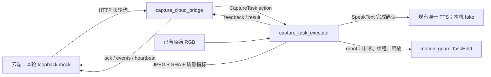

# 云端拍照任务实现与本机验收

基线 `main@62a7c59`，实施分支 `codex/cloud-capture-tasks`。本轮只做本地提交，不 push、不 SSH、不部署。四类拍照任务只上传图像，不做面诊、舌诊、安全帽或 PCB 推理。

## 1. 入口与资源关系



新增 `capture_task_interfaces` 和 `capture_task` 两包，独立于现有语音意图/执行模式；不导入 tongue_mode，不写 modes.yaml，不发布任何速度，不调用授权或复位服务。旧语音、舌苔、guard 源码保持基线不变。复制适配的少量工具在源码头注明来源。

执行器阶段：ACCEPTED → CHECK → HOLD（robot）→ ANNOUNCE → PREPARE → CAPTURE → QUALITY → UPLOAD → DONE_ANNOUNCE → UPLOADED；异常 FAILED，取消 CANCELLED。失败原因仅记录，不拿任意服务端文字播报；只播目录里的安全失败文本。

- 相机恰好一个发布者，接受 rgb8/bgr8/rgba8/bgra8，转换为 RGB；原图不缩放。准备结束才设采集窗口，同时检查接收时刻和同源 ROS 时间戳；接收龄和 ROS 帧龄均不得超过 0.5 秒。时限、网络退避、静止稳定窗口用 monotonic。
- 连拍间隔约 100 ms；默认选 Laplacian 方差最高帧。质检含亮度、清晰度、R/B 和宽高。warn 上报问题仍上传；fail 拒绝。PCB 默认最小宽度1280，不能放大凑数。
- SpeakText 的 `completed` 才能进入准备和采集。超时、取消与迟到接受只取消本任务的 goal，不调用全局语音取消。播报禁用词经 NFKC、忽略标点空白和格式字符后校验。
- bench 要求 `/cmd_vel` 零发布者；robot 要求唯一发布者名为 motion_guard，始终申请 TaskHold，并监测新鲜控制状态、owner/session、静止 odom、急停健康，0.5 秒静止稳定后才播报。租约每0.5秒续租、结束释放，迟到申请成功也释放。TaskHold 服务返回的 token 只在内存，不记录。
- robot 认可 DISARMED / ESTOP 的静止状态；**现有 guard 在 ESTOP/FAULT 拒绝 ACQUIRE**，此时任务返回 hold_failed。没有修改 guard、没有清除锁存。若检测中 authority 变成 FAULT/ARMED 或健康失效，立即失败。
- `/execution_mode/state active=true` 时拒绝新任务，执行中出现 active 也中止。robot 下同时争抢租约由现有原子 TaskHold 仲裁。ROS 拒绝 goal 没有 result transport，原因在 `/capture_task/result` 发布，bridge 在 ack 转述；接受后 HOLD 失败体现在最终 result，而非撤销 accepted ack。
- 失败通知使用独立 min(speech_timeout_sec,15秒) 时限，不受任务超时、安全/静止错误抑制；只播目录的fail_announce，关闭/外部取消/TTS本身失败时不补播。通知失败不改变原始结果，robot在通知结束后才释放租约。上传内部中止使用独立upload_cancel，不冒充外部取消。
- 上传单线程池、最大12 MiB、最多3次尝试；取消关闭 socket。上传已到云端的数据不能因取消撤回。SIGINT/SIGTERM 清理期间保持 ROS executor 运行，尽力取得自己租约的释放确认；崩溃时仍由 guard 租约超时保护。

## 2. 参数和存储

任务目录 `capture_task/config/tasks.yaml` 是四任务播报/准备/质检来源；`capture_task.yaml` 展示节点默认值；launch 提供常用参数。

| 参数 | 默认 / 约束 |
|---|---|
| cloud_url / robot_id | http://127.0.0.1:8090 / roscar-01；可用 CAPTURE_CLOUD_URL / CAPTURE_ROBOT_ID |
| token_file | 空；可用 CAPTURE_TOKEN_FILE，文件须当前用户拥有且0600；CAPTURE_CLOUD_TOKEN 环境变量优先 |
| camera_topic / camera_profile | /camera/color/image_raw / raw_rgb_v1 |
| safety_profile | bench；接底盘由整机入口强制 robot |
| storage_dir / save_images | artifacts/capture-task / false |
| with_bridge | true；仅测 action 可设 false |
| fake_tts / synthetic_camera | false；只允许 bench + localhost + 187/190隔离域 |
| hold_lease_sec | executor 参数默认3秒，合法1–10秒 |

执行器存 events.jsonl、每个已上传 capture_id 的 result.json（质量、字节数、SHA、回执，不含图像/token）。显式 save_images=true 只在整个任务成功后保存图像，取消/失败不保留本地 image.jpg。**mock 为检查协议会保存收到的图片**于 artifacts/capture-mock，均被 Git 忽略；测试后用户可自行清理这些隐私数据。

bridge 单一 HTTP worker，feedback/result 经256条有界 outbox；断网重试期间不增长线程。队列溢出会取消当前任务并淘汰最早待发送条目，因此长时间断网不能保证所有历史事件送达；重启也不持久恢复队列或去重缓存，正式云端需对账。完整10分钟 command_id 去重（按时间清理，不提前按条数淘汰）；任务ID应每次唯一。optional speak 只做协议校验，本轮返回 unsupported。

## 3. 本机启动

所有本机终端必须与车隔离，不能用182域：

```bash
cd /home/smxvjv/Desktop/works/5060wslworks/jiekou/ROS-CAR
source /opt/ros/humble/setup.bash
export ROS_DOMAIN_ID=190 ROS_LOCALHOST_ONLY=1
colcon build --base-paths ros2_ws/src --packages-up-to capture_task roscar_api motion_guard tongue_mode --executor sequential
source install/setup.bash
```

合成图像软件联调（无相机也可）：

```bash
bash scripts/run_capture_tasks_local.sh --synthetic
# 另开终端，每个任务结束后再发下一个
python3 scripts/mock_capture_cloud.py send face
python3 scripts/mock_capture_cloud.py status
```

真实 Gemini UVC 使用1920×1080 / 15fps（不要使用已知偏蓝的低分辨率模式）：

```bash
v4l2-ctl --list-devices
v4l2-ctl -d /dev/video0 --list-formats-ext
bash scripts/build_capture_usb_cam.sh    # 当前 usb_cam 0.8.1 需要；见下一节
CAPTURE_VIDEO_DEVICE=/dev/video0 bash scripts/run_capture_tasks_local.sh
python3 scripts/mock_capture_cloud.py send pcb
# 故障复测：CAPTURE_MOCK_FAIL_UPLOAD=500 bash scripts/run_capture_tasks_local.sh
```

这个本机入口同时启动 loopback mock、UVC或显式合成相机、执行器、bridge 和**假播报**，日志 artifacts/capture-local。假播报只打印中文并模拟完成，无扬声器声音；不安装真实模型，不接录音/KWS，不把它当播报听感验收。Ctrl-C 清理本入口创建的进程组。

独立 action 示例（先有相机、TTS和mock，不能重复启动另一套所有者）：

```bash
ros2 action send_goal /capture_task/run capture_task_interfaces/action/CaptureTask \
  "{task_id: 'manual-001', task_type: 'face', source: 'local_test', params_json: '{}', ttl_sec: 60.0}" --feedback
```

### 本机 usb_cam 0.8.1 时间戳修正

实测首次采集虽约14Hz，消息帧龄约0.95秒，因此被新鲜度门控拒绝。已安装的 `include/usb_cam/utils.hpp:get_epoch_time_shift_us()` 写成 `epoch_time.tv_usec / 1000.0`，使已经是微秒的字段被错误缩小，偏移会随进程启动的小数秒变化。未放宽帧龄，也未按接收时刻伪造曝光时间戳。

`build_capture_usb_cam.sh` 下载官方 ros-drivers/usb_cam 的0.8.1固定提交 `cb2ae6bc0a312de629f84fef933fb3e07dac1ef8`，只将该项改为 `epoch_time.tv_usec`，在 artifacts/capture-usb-cam 独立构建。源码、补丁构建物不进Git，不改 /opt/ros；本机入口发现有修正标记才加载overlay，若检测到已知问题且尚未修正会拒绝启动并给出命令。此修正仅用于本机 USB 联调，不改车上 Gemini 独立驱动。

## 4. 车端接入准备（未部署）

`start_project.sh` 新增 WITH_CAPTURE_TASKS=false，start_c.sh 继承。

- true 要求 WITH_VOICE=true 和 VOICE_TTS_ENABLED=true，透传已有 enable_speech_action=true；不改现有语音包，不启动第二个真实 TTS。
- WITH_CHASSIS=true 强制 safety_profile=robot，要求用户显式设置 WITH_FOLLOWER=true，否则退出码2；该入口同时启动跟随器，运动仍受 MOTION_ENABLED 与逐次授权约束。不自动打开跟随，不增加第二个guard入口。
- 没有底盘时用bench，要求 WITH_FOLLOWER=false、MOTION_ENABLED=false。现有语音舌苔 bench 需要guard，而云端拍照bench禁止速度发布者，**这两个bench入口不能并开**；两流程同时启用须 robot 配置和真实静止回传，不放宽门控。
- 订阅原始RGB，不使用 C 绘制或矫正后的画面。不切换车上分辨率、不改640×480标定。正式端点/token/robot_id须配置；默认loopback只是联调默认值。

本轮不启车端底盘、不停现有服务、不上Jetson；aarch64编译和独立域隔离验证须后续授权。

## 5. 验收与边界

证据均在本机 artifacts/capture-validation，不入Git。

| 项目 | 结果与层次 |
|---|---|
| P0依赖 | 本机Humble、colcon、usb_cam、image_publisher、v4l-utils齐全；DDS187/190 + localhost |
| P1/P2纯Python | 目录、指令、回执、禁用词、私有token、质检、时钟、新鲜帧、编码、上传重试/409/401/取消等；阶段性27项，加入入口门控和异常回执后37项 |
| P2子集编译 | 原生Humble x86_64，18包通过 |
| P2/P3运行时 | 10场景通过：四任务SHA、忙时/语音active拒绝、缺失/重复相机、bench速度门控、播报/上传取消与迟到接受、bridge完整事件、去重/过期/匹配取消、断网与401恢复 |
| P3资源 | 连续20任务后线程增量0、FD增量0（该次模拟运行）；不是无限时稳定性保证 |
| P5 robot模拟 | 真实motion_guard软件、motion_enabled=false + 假odom/KWS；租约申请/续租/释放、急停锁存拒绝均通过；不是小车验收 |
| 退出清理 | 真实相机任务PREPARE阶段SIGTERM执行器，CANCELLED最终事件送达；本机入口全部进程已清理 |
| P5整仓编译 | 本机21主动包Humble编译通过，厂商COLCON_IGNORE包未参与 |
| P4相机 | 用户已接入Gemini彩色UVC，选择只做采集，不做人工摆拍；最终采集指标及四任务结果见下面记录 |

回归命令：

```bash
bash scripts/ci_unit_tests.sh
python3 scripts/check_project.py
git diff --check
source /opt/ros/humble/setup.bash
source install/setup.bash
ROS_DOMAIN_ID=187 ROS_LOCALHOST_ONLY=1 python3 tests/test_capture_task_runtime.py
ROS_DOMAIN_ID=186 ROS_LOCALHOST_ONLY=1 python3 tests/test_speech_api_runtime.py
```

真实相机实际记录（1920×1080、usb_cam独立修正overlay、假播报）：

- 12秒采集177帧，约14.75 Hz，R/B=1.0003；后续同时运行回归时164帧、13.66 Hz，帧龄0.070–0.094秒，R/B=1.0112。均只有1个相机发布者、0个/cmd_vel发布者，满足本机采集门槛。此R/B仅为当前场景的诊断指标，不是色卡标定。
- 四任务均UPLOADED，mock收到JPEG的SHA256与执行器记录一致。测试拍的是当时镜头前场景，没有安排真人/实物摆拍。

| 任务 | 亮度 | 清晰度方差 | R/B | 质量提示 |
|---|---:|---:|---:|---|
| face | 185.45 | 31.98 | 1.0003 | 无 |
| tongue | 185.44 | 31.87 | 1.0013 | 无 |
| helmet | 185.27 | 32.21 | 1.0002 | 无 |
| pcb | 185.27 | 31.78 | 1.0028 | sharpness_below_minimum，按warn上传 |

这些数字只描述画面，不能表明面部/舌体/安全帽/PCB存在或可识别；PCB清晰度人工验收仍待摆放实际电路板。真实播报使用fake，因此没有听感结果。人工面部/舌头/安全帽/PCB内容、准备时间体验、真实MeloTTS听感均未验收；云端推理和诊断准确率不在本轮范围。后续还需确定正式HTTPS地址、身份/token轮换、结果播报需求、车端高分辨率与C标定协调、Jetson隔离编译和性能。
