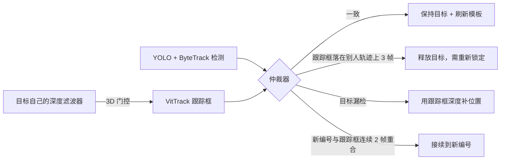

# 单目标跟踪器与选人联动

日期：2026-10-12。状态：软件已实现，默认关闭；录像离线模拟和合成 ROS 测试已通过，未在 Jetson 上运行，未做实车验收。

## 要解决的问题

选人模块 `Selection` 按 ByteTrack 编号跟目标，原有两个弱点：

1. **目标轨迹消失时**：在 1.2 秒内按中心距离和面积挑"最近的框"接上。两人交叉时很容易接错人。
2. **察觉不到换号**：ByteTrack 在两人重叠时可能把编号对调，目标编号还在，选人模块会直接跟着错。

位置滤波器（`DepthTrackFilter` 等）按编号各自滤波，回答的是"这个编号在哪"，不负责身份连续性。

## 做法

加一个单目标跟踪器（VitTrack），只盯当前选中的目标，作为连续性证据交给仲裁器 `BridgeArbiter`。仲裁器**只能保持、确认后接续或放弃目标，永远不会自己挑人**。



规则（`yolo_person_tracker/sot.py`）：

| 规则 | 内容 |
|---|---|
| 只在一致时刷新模板 | 跟踪框与目标框 IoU ≥ 0.5，且目标没和别人重叠（与 ReID 裁剪相同的 10% 规则），才用目标框重新初始化模板 |
| 深度门控 | 每帧取跟踪框的 B 区域测距点，送入跟踪器自己的 `DepthTrackFilter`（与节点共用 `DepthGate`）；连续 2 次被拒就停止桥接。挡在前面的人通常更近，或横向位置跳变，都会被拒 |
| 得分与时长 | 跟踪得分 < 0.35 停止；距上次刷新超过 3 秒停止 |
| 换号冲突 | 目标在场，但跟踪框落在另一条轨迹上（IoU ≥ 0.5）且离开目标框（IoU < 0.3），连续 3 帧 → 释放目标 |
| 接续 | 目标不在场，跟踪框与某条轨迹连续 2 帧重合 → 接续到该轨迹；**曾与目标同框的轨迹一定是别人，不能接续**，跟踪框停在这种轨迹上按冲突计数 |
| 中断期间重叠 | 桥接中断时目标和别人重叠过，之后不再从这条轨迹重新启动桥接，判为丢失，需要重新确认身份 |
| 补位置 | 目标漏检、桥接有效时，用跟踪框深度作为**退路测量**（门限更严、噪声更大）送入该目标自己的滤波器，`TargetState` 标为 `Bridged` |

开启后原有的"最近框接续"关闭（`Selection(nearest_reacquire=False)`），只有仲裁器确认的 `handover()` 能改变目标编号。位置滤波器的参数、门控和测量年龄都不变；补位置只作为退路测量进入目标自己的滤波器，不搬旧坐标。

## 启用

```bash
SOT_ENABLED=true bash scripts/start_c.sh
# 或
ros2 launch perception_bringup perception.launch.py route:=yolo_pose ... \
  sot_enabled:=true sot_model_path:=/absolute/object_tracking_vittrack_2023sep.onnx
```

- B、C 路线都可用（参数在 `TrackerNode`），默认关闭；关闭时节点行为不变。
- 必须指定本地模型和同名 `.onnx.json` 校验文件；缺失或无法加载时拒绝启动，不回退。
- 可与 ReID 身份锁定同时开启（`REID_ENABLED=true REID_LOCK_ENABLED=true SOT_ENABLED=true`），行为见下文"与 ReID 身份锁定合用"。
- 其余参数（节点参数，均有默认值）：`sot_backend`（auto/onnxruntime/opencv/tensorrt）、`sot_min_score`、`sot_max_bridge_s`、`sot_depth_rejects`、`sot_conflict_frames`、`sot_handover_frames`、`sot_mask_refresh`（默认 true），以及 C 节点的 `reid_lock_bridge_carry_s`（默认 3 秒）。

## 模型与运行环境

- 模型：OpenCV Zoo `object_tracking_vittrack_2023sep.onnx`，714,726 字节，Apache-2.0，来源提交 `fef72f8`，经用户同意下载，登记在 `models/manifest.json`。
- ROS Humble 自带的 OpenCV 4.5.4 无法加载该模型（不支持 HardSwish 算子），也没有 `cv2.TrackerVit`。因此按 OpenCV 4.10 `tracker_vit.cpp` 逐行移植了 numpy 前后处理，推理后端可选 onnxruntime、OpenCV ≥ 4.8 DNN，或下述显式目标板 TensorRT engine。
- 与 OpenCV 自带实现对比（每帧从相同的上一帧框出发）：97% 的帧框差 ≤ 1 像素，最大 3 像素，得分差 ≤ 0.0026；两种后端结果相同。
- Mac CPU 耗时：onnxruntime 约 15 ms/帧，OpenCV DNN 约 44 ms/帧。Jetson demo已复用现有onnxruntime；2026-10-19在同板同录像109组输入上，CPU更新中位约16ms，显式FP32 TensorRT约8ms；这是离线计算对比，不是实车跟随或身份准确率验收。

## 录像离线评估

方法：在 10-10 B（两人衣着差异明显）和 10-09 B2（三人衣着相近、偏蓝）上，用正式 `Selection` 逐帧模拟选人，对比原逻辑和加入仲裁器两种情况。参考标签：10-10 用衣着颜色，B2 用人工逐轨迹标注。目标丢失后，两种情况采用相同的"目标清晰可见时重新锁定"规则，代表用户或 ReID 重新锁定。

结果（单位：帧，约 12–15 帧/秒）。"跟错"指报告的目标框落在别人身上；"沿用旧框"指目标刚消失时原有 0.8 秒保持期内沿用的旧框与别人重叠，期间位置来自目标自己滤波器的短时预测，不是在跟那个人。

| 目标 | 原逻辑：正确 / 跟错 | 加仲裁器：正确 / 跟错 / 沿用旧框 | 无目标帧 原→新 |
|---|---|---|---|
| 10-10 A | 818 / 76 | 810 / 4 / 1 | 169 → 214 |
| 10-10 B | 298 / 213 | 468 / 12 / 0 | 567 → 600 |
| B2 G | 608 / 613 | 718 / 1 / 14 | 194 → 837 |
| B2 W | 521 / 748 | 1007 / 0 / 34 | 147 → 533 |
| B2 D | 516 / 150 | 602 / 0 / 20 | 1047 → 1095 |

- 10-10 剩下的跟错多为两人重叠瞬间的 1 帧。还有一部分是参考标签被污染：被挡在后面的人，躯干颜色取到了前面那个人的衣服。逐段截图见 `artifacts/reid-eval-20261011/sot/wrong_*.jpg`。
- 代价是"无目标"帧增加：原来在跟错人的时段，现在改为丢失后等待重新确认，符合宁可丢也不跟错的原则。
- 单独桥接（不含仲裁）时，加深度门控把跟错帧从 32/34/46/49/55 降到 5/20/14/3/36。D 与 W 并排、距离相同时深度无法区分，这时主要靠"同框过的轨迹不能接续"兜底。
- 评估中修正的问题：同一帧先推进再刷新被误判为时间倒退（桥接频繁中断）；中断期间编号对调后从错的轨迹重启；接续到曾经同框的轨迹；跟踪框停在别人身上时仍报位置。

边界：两段录像都不是按脚本拍的标准 ReID 数据，参考标签在重叠时并不完全可靠；离线模拟使用 stride 2 的缓存检测，没有真实推理延迟和丢帧；车体和云台运动下的表现未知。

## 测试

- `test/test_sot.py`（13 项）：裁剪补边、Hanning 窗、模型校验，以及桥接的得分/时长/深度停止、同帧刷新，仲裁的一致刷新、换号释放、确认接续、同框轨迹不接续、中断期间重叠判丢失。
- `test/test_state.py` 新增：关闭最近框接续、显式 `handover()`。
- `tests/test_sot_runtime.py`（已加入 `scripts/test_c_container.sh`）：在真实 `TrackerNode` 中用注入的检测和脚本化跟踪器，验证一致时刷新、换号释放、桥接深度补位置、确认接续，以及跟踪框停在同框过的人身上时不报位置、不切换。
- 评估脚本和数据在 `artifacts/reid-eval-20261011/sot/`（不入库）：`sot_eval.py`、`bridge_eval.py`、`select_sim.py`、`wrong_frames.py`。

## 第二轮改进（2026-10-12）

1. **去掉沿用旧框**：开启联动时，`Selection` 的 `track_hold_s` 改为 0。目标刚消失时不再沿用最后一个检测框（它常压在走过来的另一个人身上），而是由跟踪器桥接；桥接无效就直接报丢失。
2. **冲突帧暂停输出**：跟踪框与目标轨迹不一致的帧，`TargetState` 立即报 `LOST`（detail 以 `Paused` 开头），不再等连续 3 帧判定释放后才停。
3. **拥挤时掩码刷新模板**（`sot_mask_refresh`）：目标和别人重叠、但跟踪框与目标框一致时，用 ReID 同款骨架轮廓把更近的人涂成均值灰，再刷新模板；目标躯干被挡超过一半或缺少骨架时不刷新。B 路线没有骨架，此项不生效。
4. **与 ReID 身份锁定合用**：
   - **区分"没证据"和"有反证"**：ReID 授权（连续 3 次确认）后，如果跟踪器之后每一帧都与目标一致，ReID 暂时没有确认结果时不作废授权，最长延续 `reid_lock_bridge_carry_s`（3 秒，从最近一次 ReID 授权算起）。ReID 确认目标轨迹是别人，或主人出现在别的编号上时，仍立即作废。
   - **漏检与接续**：目标漏检、跟踪器仍连续时保留授权；跟踪器确认的接续可把身份带到新编号，之后由 ReID 继续核验。
   - **冲突后自动重新确认**：仲裁器判定冲突时，只作废当前授权，不释放目标，由 ReID 自动在主人所在的轨迹上重新确认，无需人工重新锁定。
   - **只延续可信的身份**：用户锁定的轨迹（及跟踪器从它连续接续过去的轨迹）可信；ReID 把身份跳到一条新轨迹上时，要在该轨迹上持续确认满 `trust_s`（2 秒）才可信；跟踪器判定冲突后清除可信标记。
   - **重叠时不延续**：目标与别人重叠（10% 规则）的帧，跟踪器不延续身份。分开后必须由 ReID 重新确认。
   - 不开跟踪联动时，身份锁定的行为与原来完全一致（`carry_s=0`），原有测试全部在这一配置下重跑通过。

   后两条来自视频复核：B2 的 W 片段在 51.2 秒时，ReID 正确地把 W 确认到轨迹 #30 上；53.0–53.4 秒 G 挤过来、两人高度重叠，ByteTrack 把 #30 换成了 G，单目标跟踪器也一起被带偏。两者都没察觉，延续规则于是把 W 的身份在 G 身上维持了约 2.5 秒（32 帧跟错）。加上这两条后，这类情况为 0。

### 评估（同一录像、同一检测；单位：帧）

前四种模式在目标丢失后沿用"目标清晰可见时模拟重新锁定"；ReID 两种模式只在开头锁定一次，之后全靠 ReID 自动重新确认，更接近实际使用。ReID 使用正式代码、`reid.yaml` 参数和重叠掩码特征，每秒 5 次。

| 目标 | 原逻辑 正确/跟错 | 第一轮联动 正确/跟错/旧框 | +去旧框 | +掩码刷新 | 只开 ReID 锁定 | ReID 锁定 + 联动 |
|---|---|---|---|---|---|---|
| 10-10 A | 818/76 | 810/4/5 | 810/6/0 | 810/2/0 | 323/0 | **430/0** |
| 10-10 B | 298/213 | 469/9/4 | 469/14/0 | 464/10/0 | 166/0 | **197/0** |
| B2 G | 608/613 | 720/0/16 | 736/1/0 | 767/1/0 | 0/0 | 0/0 |
| B2 W | 521/748 | 1009/0/34 | 1009/0/0 | 977/0/0 | 0/0 | 0/0 |
| B2 D | 516/150 | 604/0/22 | 616/0/0 | 619/0/0 | 12/0 | 12/0 |

最后一列是加上"只延续可信身份"和"重叠时不延续"后的结果。在此之前分别是 A 570/0、B 198/2、D 97/0；加"可信"后是 A 466/0、B 198/2、D 97/0。D 的收益原本来自重叠期间的延续，现在被安全规则取消。

- 去旧框后，"旧框压在别人身上"全部归零；掩码刷新让多数片段的跟错或正确帧进一步改善，W 的正确帧略降（1009→977）。
- ReID 锁定 + 联动在 10-10 中让 A 的有效跟随帧从 323 增加到 430（+33%），B 基本持平（166→197），全部片段没有跟错。之前 B 在 63.6 秒编号对调首瞬间的 2 帧跟错，已被"重叠时不延续"消除。
- B2 中 ReID 锁定几乎无法授权：三人衣着相近、录像偏蓝，ReID 很少给出确认（见身份 ReID 文档），所以 G、W 全程没有输出，D 只有少量。这是安全但不可用的结果，需要正常色彩的录像和"只认主人"的登记机制才能改善。
- 与带模拟重新锁定的模式相比，ReID 模式的"正确"帧明显更少，说明实际可用性仍受 ReID 覆盖率限制。

验证：`test_identity_selection.py` 新增 4 项（延续只在跟踪器一致且未超时时有效、反证立即作废、接续保留身份且漏检不作废、不开跟踪联动时行为不变），并在开启延续的配置下重跑原有 10 项；`test_sot.py` 新增掩码刷新 1 项；运行时测试补充冲突帧暂停输出、去掉旧框，以及 ReID 锁定与跟踪联动同时开启时的装配。本机 CI 241 项、ARM64 Humble 容器完整 C 测试套件通过（`artifacts/reid-eval-20261011/sot/c-acceptance-items123.log`）。仍为离线与合成验证。

## 以跟随稳定为目标：联动主线 + ReID 找回（2026-10-12）

用户更看重跟随稳定（不频繁中断、不在人之间跳），所以改用更贴近跟随体验的指标：只统计目标在画面里的时间，看有正确输出的比例、每分钟中断次数、超过 1 秒的中断、最长中断和跟错次数（`artifacts/reid-eval-20261011/sot/stability.py`）。结论是 ReID 身份锁定（每 0.5 秒都要 ReID 授权）对跟随来说可用性太低，于是新增第三种选人方式：

**`reid_reacquire_enabled`（C 路线，`OwnerSelection`）**，需要 `sot_enabled` 和 ReID 观察节点，与 `reid_lock_enabled` 互斥：
- 锁定后立即跟随，连续性由 ByteTrack + 单目标跟踪器仲裁负责，ReID 暂时没确认不会停。
- ReID 连续 3 次把目标轨迹认成同一个持久身份，就绑定为"主人"。
- **否决**：ReID 连续 2 次认出目标轨迹是别人，或主人出现在别的编号上，就放下目标，进入"寻找主人"。
- **自动找回**：寻找期间，ReID 连续 2 次在某条轨迹上确认是主人，就恢复跟随；目标漏检又没有桥接超过 1 秒，也进入寻找。
- 主人尚未绑定就丢失时，无法自动找回，需要重新锁定（`TargetState` detail 以 `Owner:` 开头说明原因）；寻找期间不会自动锁定单人。
- C 节点在话题 `owner_focus`（`PersonIdentity`）上发布主人身份和正在跟的轨迹；ReID 节点据此**固定主人记忆**（不受 30 秒过期限制）并在**目标未与别人重叠、ReID 确认是主人时补充多视角外观**（`owner_views: 24`，比对时取原外观与多视角中最近的一张）。超过 1 秒未收到该话题则不使用。

启用：

```bash
REID_ENABLED=true SOT_ENABLED=true REID_REACQUIRE_ENABLED=true bash scripts/start_c.sh
```

### 稳定性对比（目标可见时）

| 目标 | ① 原逻辑 | ② 联动 + 模拟人工重锁（上限） | ④ ReID 锁定 + 联动 | ⑤ 联动 + ReID 找回 | ⑦ ⑤ + 主人记忆不过期 + 多视角 |
|---|---|---|---|---|---|
| 10-10 A | 99%，跟错 1 次 | 98% | 52%，最长中断 21 s | 80% | **81%** |
| 10-10 B | 64%，跟错 4 次共 14.7 s | 95% | 40%，最长 56 s | 48% | **66%** |
| B2 D | 81%，跟错 5 次共 9 s | 96% | 2% | 21% | 21% |
| B2 G | 63%，跟错 2 次共 37 s | 79% | 0% | 24% | 24% |
| B2 W | 46%，跟错 4 次共 48 s | 77% | 0% | 3% | 3% |

（百分比为目标可见时有正确输出的时间比例。⑤⑦ 除 10-10 B 一次约 0.2 秒外没有跟错。）

- ⑤⑦ 不需要人工干预，比 ReID 锁定稳定得多；与 ② 的差距就是 ReID 找回主人的速度和成功率。
- 主人记忆不过期让 10-10 B 离开约 40 秒后能被认回来（48%→59%），多视角再到 66%。
- B2 中 ReID 在跟随开始阶段就没能绑定主人（偏蓝、衣着相近），所以找回功能用不上。这需要正常色彩的录像来评估。
- 底盘控制层仍是主要瓶颈：`person_follower` 目标一帧不可用就发零速度；`motion_guard` 跟随模式下目标一帧无效即进入 FAULT 且不自动恢复。感知侧的短暂停顿在实车上都会变成停车并需要重新授权。这一项涉及运动安全规则，需用户确认后再改（见 WORKLOG）。

测试：`test_owner_selection.py` 7 项（立即跟随、否决需连续证据后寻找并找回、主人在别的编号即否决、无桥接缺失后丢失且未绑定需重锁、桥接保持、未记录/过期帧忽略、释放清除主人）；`test_reid.py` 新增 3 项（主人不过期、多视角只来自跟随中未遮挡且已确认的主人、新视角扩展识别范围）；运行时测试补充 `OwnerSelection` 装配、`owner_focus` 发布和缺少 `sot_enabled` 时拒绝启动。ReID 节点订阅 `owner_focus` 的 ROS 路径尚无运行时测试。本机 CI 273 项、ARM64 Humble 完整 C 容器套件通过。离线模拟与合成测试，不是 Jetson 或实车验证。


## Demo显式FP32 TensorRT入口（2026-10-19）

只在目标Jetson构建，使用相邻的原ONNX及其哈希清单；不下载或转换成FP16。已有输出时脚本拒绝覆盖。

```bash
bash scripts/build_vittrack_engine.sh models/weights/object_tracking_vittrack_2023sep.onnx models/weights/object_tracking_vittrack_2023sep-fp32.engine
```

显式设置 `SOT_MODEL_PATH` 为构建出的绝对engine路径；`sot_backend=auto`会按该扩展名只使用TensorRT，也可显式`tensorrt`。原ONNX仍只使用既有auto/onnxruntime/opencv路径，不能用tensorrt参数静默构建。TensorRT运行需现有Pose Python中的Torch/CUDA与TensorRT10；IO固定为template(1,3,128,128)、search(1,3,256,256)和三个16×16输出，全部FP32。源ONNX、源清单、engine清单及哈希不匹配或设备不兼容均报错，没有CPU回退。

实际demo私有env仅新增SOT_MODEL_PATH指向 `/home/wheeltec/ROSCAR-demo-20261016/models/weights/object_tracking_vittrack_2023sep-fp32.engine`，备份保留在板上私有配置目录，权限0600。开机仍运动关闭，运行时测试仍不自动授权。回退只将该变量改回相邻原ONNX后重启停车服务，通用默认不改。engine和实拍数据不提交Git。

同一批109组真实配准画面/检测种子，CPU/GPU框差为0像素，三个原始输出最大绝对差约1.85e-6、score最大差约3.58e-7，生产score门槛决策一致。仲裁器、同框陌生人排除、深度矛盾检查、桥接时限和身份恢复规则未更改。这些结果不能证明未标注场景不会误跟；最新跟随复测与剩余项见[阿克曼跟随与测距核对](demo/20261019阿克曼跟随与测距核对.md)。
