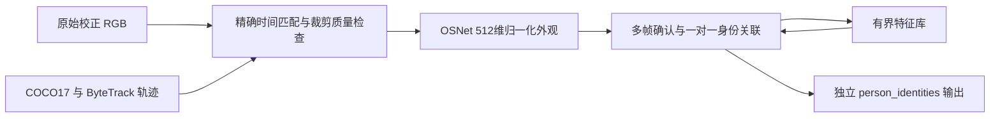

# C 身份 ReID 接入与验收

日期：2026-10-03。状态：会话内身份观察层与可选身份锁定恢复已实现。观察层模型验证已完成；锁定恢复的软件验收见下文。现场多人/遮挡准确度和 Jetson 性能尚未验收；10-11 双人录像离线评估见文末，衣着相近时出现错误接续。两个开关分别默认关闭，不转移身高先验，不启动车辆。

## 两层 ID 与范围

`epoch:track_id` 仍由 ByteTrack 产生。ReID 增加 `会话随机前缀:person_0001` 等身份，并维护它与当前轨迹的关联。新轨迹只有在连续多个有效外观观测通过时才能接回旧身份。身份仅表示外观匹配假设，不识别真实姓名，不保证唯一生物身份。



- 新人注册默认需3次一致的采样，采样上限5Hz；不是每帧无条件注册。缺点、模糊、多人重叠、低检测置信度及退化躯干几何暂停采样。
- 当前用完整人体框提取OSNet特征；骨架用于检查可见性/裁剪质量，不把它包装成部位训练的网络或骨骼比例身份识别。需要双肩双髋有效及至少6个可见点；在已跟踪人体框之间检查重叠。尚未利用未跟踪检测框、分割掩码或人脸。
- 每次采样也检查已有映射；同一ByteTrack编号出现矛盾外观，立即停止输出已确认关联，不先把新外观混进旧特征库。
- 新轨迹需同时满足距离门槛、与次佳身份的间隔、与其他当前轨迹竞争同一身份的间隔，以及一对一占用约束。没有充分证据就输出PENDING/AMBIGUOUS，不强行选最近的人。
- 已绑定但因遮挡而无法核验的可见轨迹，保留身份占用，防止旁人趁低质量期间借走；恢复质量后需要重新多帧确认。身份本人不再出现时才释放轨迹占用。
- 特征库保留初始注册中心，在线更新不能漂移该中心；只加入与身份非常一致的高质量观测。每人最多8个样本，最多64个身份，失去有效观测30秒后过期。内存中保存特征，不持久化到硬盘；节点重启建立新会话。
- ByteTrack换epoch不会按数字ID直接继承身份；只能重新凭外观确认。断流超过max_gap_s会清除当前关联并重新确认，时间倒退清空身份库，身份编号不复用。
- 本阶段不使用未经运动补偿的位置门控，不以深度是否有效作为身份识别前提。位置融合后可以再接入共同坐标系门控。上游Pose当前仍使用现有RGB-D入口；这次没有新增RGB-only采集路线。

## 模型与来源

使用 [作者 Torchreid Model Zoo](https://github.com/KaiyangZhou/deep-person-reid/blob/f8cd150fdf77e8d9e1ed143b7f308c2c609ded50/docs/MODEL_ZOO.md) 的 **OSNet-x0.25 / MSMT17 同域 ReID 权重**，不是该表前半部的ImageNet预训练权重；不套用OSNet-AIN或完整大模型的论文指标。

- 作者架构源码固定提交 `f8cd150fdf77e8d9e1ed143b7f308c2c609ded50`，未经修改放在 `yolo_person_tracker/vendor/osnet.py`。MIT原许可证与源码哈希随包保留。
- checkpoint：`osnet_x0_25_msmt17.pth`，3,057,863字节，下载自作者Model Zoo所链接的Google Drive，SHA-256 `6f57607fed9f502b9efed546108132ee715df5a5b6e6932c6269bacb47f59f99`。哈希是本次取得文件后记录的固定校验值，不声称作者另外发布了签名。
- 本机导出ONNX：891,011字节，RGB 256×128、ImageNet均值/标准差、输出512维特征后L2归一化。运行使用OpenCV DNN CPU，不依赖运行时Torchreid/GDrive，不自动下载或切换其他模型。模型与同名`.onnx.json`校验文件必须一起准备。
- 权重与ONNX在忽略的模型目录中；来源/哈希另记入版本控制中的`models/manifest.json`。代码MIT许可保留；模型及训练数据的使用条件以作者/数据集说明为准。

本机复用已有`.venv`的PyTorch，补装onnx 1.17.0用于显式导出；没有新建大型环境。

```bash
# 已有兼容 torch/onnx 的 Python 环境中运行；首次需要下载时显式 --download：
.venv/bin/python scripts/prepare_reid_model.py --download
# 仅本地 checkpoint 导出，不联网下载：
.venv/bin/python scripts/prepare_reid_model.py
```

导出会以真实PyTorch权重与OpenCV输出对比；缺文件、哈希不符、缺必要依赖会报错，不产生“已验证”的替代模型。

## 启用与观察

在已构建且已有相机输入的环境，C route新增 `reid_observer`；默认`reid_enabled=false`，不加载模型、不订阅RGB。沿用当前C采集、模型和标定参数，额外加入：

```bash
ros2 launch perception_bringup perception.launch.py route:=yolo_pose \
  model_path:=/absolute/yolo26s-pose.pt \
  color_topic:=/camera/color/image_rect \
  depth_topic:=/camera/aligned_depth_to_color/image_raw \
  camera_info_topic:=/camera/color/camera_info_rect \
  reid_enabled:=true \
  reid_model_path:=/absolute/osnet_x0_25_msmt17.onnx
```

若使用现有C一键入口，在满足原相机/模型条件的Jetson环境设置：

```bash
REID_ENABLED=true \
REID_MODEL_PATH="$PWD/models/weights/osnet_x0_25_msmt17.onnx" \
bash scripts/start_c.sh
```

本轮没有在小车执行上述启动。`REID_CONFIG` / `reid_config` 可指定配置文件；启动开关与模型路径来自上述环境变量/launch参数。其他阈值见 `ros2_ws/src/perception_bringup/config/reid.yaml`，均为初始值，需现场验证。

`/perception/person_identities` 输出 PersonIdentityArray：精确保留RGB观测header、有效性、处理耗时、观测年龄，以及各轨迹的持久身份、核验状态、可见性、余弦距离和原因。距离不是匹配概率；未确认时person_id为空。失踪身份会以track_id为空、verified=false、visible=false、state=LOST列出，**不包含位置**。断流/过期/模型错误输出valid=false空列表；不把过期结果赋予新时间。

RGB与Pose使用精确时间及frame匹配（Pose继承原RGB时间），不使用缩放后的预览图。最多缓存20组消息、单推理worker、最多8人，忙时丢弃新任务而非积压；过期结果拒绝，错误不会阻塞状态心跳。模型缺失只让独立身份层报错，原C跟踪链路仍可运行。

Foxglove `c-layout.json` 提供身份RawMessages面板。TargetState.target_id仍是当前epoch:track_id，身份映射在person_identities查看；persistent ID不会写入ground的个体确认参数。

## 验证与限制

- 纯逻辑：注册、换轨迹恢复、同轨迹换人、多人竞争、相似新人拒绝、质量冻结、长期占用、双人交换、容量/TTL、时间倒退、epoch、图库不漂移及特征维数检查。
- ROS：精确RGB/Pose配对、缺模型、身份恢复、矛盾/低质量/模拟输入拒绝、断流、阻塞worker心跳与过期完成丢弃，无目标/运动输出。测试使用显式合成descriptor，不能作为实际ReID精度。
- 真实模型：PyTorch→ONNX/OpenCV归一化特征最大差约 `1.9e-7`；Mac与Linux ARM64 Humble/OpenCV 4.5.4在真实照片裁剪上的最大特征差小于 `3.1e-7`。
- 真实照片采用本机Ultralytics官方bus.jpg。原整图4人因重叠/躯干缺点全部被质量规则拒绝，这个结果保留。另取2个独立人体裁剪验证模型和ROS链路，特征间距约0.463；重复同一裁剪并人为换track ID能够接回，换成另一人的裁剪会拒绝继承。**这是受控静态图验证，不是真实遮挡、多人交叉或跨视角准确率**，没有为样例通过而放宽质量门槛。
- Mac两次单裁剪CPU调用约12.4/5.4ms，Mac承载的ARM64容器约6.9/3.5ms；只有少数调用，既不是稳定帧率测评，也不是Jetson性能。
- 待现场验证：真实遮挡恢复、相似衣着误认、视角/光照变化、误报/漏报及重新确认时延；保守质量规则可能频繁不输出。无外观证据时不保证恢复；当前不支持跨节点重启的长期身份。

可复现命令：

```bash
# 真实模型与本地公开示例图（该路径依本机Python版本而定）：
.venv/bin/python scripts/smoke_reid_model.py \
  --image .venv/lib/python3.12/site-packages/ultralytics/assets/bus.jpg
bash scripts/test_reid_model_container.sh
ROSCAR_C_TEST_LOG="$PWD/artifacts/c-reid-final.log" bash scripts/test_c_container.sh
```

证据：`artifacts/reid-export.log`、`reid-smoke/report.json`、`reid-arm64-model.log`、`reid-unit-final.log`、`c-reid-final.log`；最终测试数量与退出码以WORKLOG为准。

## 可选身份锁定恢复（2026-10-03）

在原C入口额外设置 `REID_ENABLED=true REID_LOCK_ENABLED=true`，或launch同时设置 `reid_enabled:=true reid_lock_enabled:=true`。缺少观察层开关时，组合launch明确拒绝；缺模型/无有效身份时，身份锁定保持LOST，不回退邻框接续。默认不启用，B和原C行为保留。

- lock_target仍选择画面中央轨迹，auto_lock_single仍需单人连续出现；选定后先等待身份确认。锁定恢复模式关闭原Selection的邻框重关联、缺人保持和自动换人。
- 默认额外要求3个不同采集时间的已核验身份结果（`reid_lock_confirm_frames`，至少2）。首次建立身份、换轨迹、失效恢复均需确认；观察层自身的多帧确认仍保留，所以总延迟比单独观察层更长，需现场测量。
- 只接受本节点已输出Pose的精确RGB时间戳和frame，最近64帧有界缓存；要求轨迹属于该帧且仍在当前候选中，当前人员身份映射一对一。重复、锁定前或乱序结果不增加计数；未知header、歧义、低质量、矛盾或无效结果撤销有效位置。
- 证据期限默认0.5秒（`reid_lock_max_age_s`），按采集时间计龄；迟到推理不刷新完整期限。旧证据仍有效的短间隔可继续输出，但一旦收到否定证据立即失效。身份从采样后发生变化到下一次采样间存在不可避免的检测延迟。
- 人体消失后立即LOST。新轨迹通过确认后TargetState.target_id改为它自己的epoch:ID，位置只取该轨迹的深度与滤波结果，仍遵守原测量年龄；不搬旧坐标或旧滤波器。不改变身高先验绑定。组合入口也同步约束地面目标输出：身份锁定未确认时target_state_ground保持无效；全体人员的地面几何估计仍可独立显示。
- epoch变化保留已锁定持久身份，但清空确认和缓存，只能凭新epoch的外观结果恢复；观察层重启/图库过期无法识别旧身份时保持LOST，需要显式重锁。释放清除身份并抑制自动锁定；主动重锁建立新的确认过程。
- 这是感知选人功能，不发布速度，也未部署到小车。外观误认仍可能导致错误接续，软件规则不能代替真实多人验收。

测试入口：`tests/test_identity_lock_runtime.py` 已纳入 `scripts/test_c_container.sh`；纯逻辑 `test_identity_selection.py` 覆盖恢复、多人竞争、交叉换ID、同ID换人、释放/重锁、epoch、超时、重放及缓存边界。ROS测试使用合成检测与身份消息，不作为实际ReID准确率或相机验收。

本阶段最终软件回归：Linux ARM64 Humble 14包构建、103项感知逻辑及相关ROS回归通过，含地面目标身份门控、缺少观察层时拒绝启动；日志 `artifacts/c-identity-lock-final.log`。不计入真实场景准确率验收。

## 双人录像离线评估（2026-10-11）

用 `scripts/analyze_gemini_recording.py --reid` 离线回放两段双人录像，`reid.yaml` 默认参数未改。主结果用 stride 6（约 4–5 Hz，与 `reid_node` 的 `sample_hz=5` 一致），Pose/ByteTrack 来自同录像 stride 2 缓存；另跑 stride 2（12.5–15 Hz）作采样率对照。录像没有逐帧身份标注，核对方式：10-10 用两人衣着颜色（躯干饱和度、大腿亮度）做弱参考标签，另人工查看全部身份事件帧；10-09 衣着相近且偏蓝，逐张人工查看全部确认输出的人体裁剪。

| 录像 | 实际内容 | 采样 | 持久身份数 | 确认输出 | 误认 |
|---|---|---|---|---|---|
| 10-10 B | 2 人，衣着差异明显（卡其外套+黑裤 / 灰白上衣+灰裤），色彩正常；有并排、互相走过和 ID 交换，未完整做脚本中的三次交叉、完全遮挡和背对段 | 4.2 Hz | 3 | 134（A 66、B 68） | **0** |
| 10-10 B | 同上 | 12.5 Hz | 6（A 被拆成 4 个） | — | 0 |
| 10-09 B2 | 偏蓝；实际至少 4 人（含坐椅、躺垫的人），浅色上衣相近；未按脚本 | 5 Hz | 2 | 66 | **0001 的 50 个输出中 44 个是另一人；0002 的 16 个混有至少两人** |
| 10-09 B2 | 同上 | 15 Hz | 1 | 286 | 所有人（含坐着的人）被并入同一身份 |

10-10 B 的细节：

- 覆盖率低：A 单独在画面时 48% 的样本有确认身份，B 单独 69%，两人同框 18%。原因是 A 本人不同视角的外观距离中位 0.30（只有 31% 的帧对 ≤0.25），已核验的距离 p90 为 0.241，转身、弯腰时频繁落到 0.26–0.37 的 AMBIGUOUS 区间。
- 两人之间距离 p5 为 0.43，没有一对 ≤0.25（`match_distance`），8.6% 小于 0.45（`new_identity_distance`）。在衣着差异明显时门槛有余量，偏保守。
- 63.6 s 两人前后交叠，ByteTrack 把轨迹 4/7 对调；ReID 立即解除原映射，约 1.2–2.2 s 后按外观正确改绑（64.8 s 轨迹 4→B、65.8 s 轨迹 7→A），期间只输出 AMBIGUOUS/UNVERIFIED，没有错误身份。
- B 离开约 41 s（超过 `retention_s=30`）后重新进入，被注册为新的 0003。这符合设计，但锁定恢复在这种情况下会保持 LOST。

10-09 B2 的细节：

- 0001 在 9.0 s 由 T 恤+浅灰裤的人（轨迹 2）注册，16.1 s 以距离 0.142 接续到穿白卫衣+黑裤、离相机很近的另一人（轨迹 3），之后 16–30 s 一直输出这个错误身份。距离远低于 0.25，调门槛无法避免。
- 0002 在 61.6 s 注册后，接续的轨迹中既有浅灰裤的人（62、98–99、114 s），也有深色裤的人（73–74、82、102 s）。
- 这段偏蓝会削弱颜色信息，而且人数和动作都不符合脚本，不能单独代表“正常色彩、衣着相近”的表现；但它说明 OSNet-x0.25 整身特征在衣着相近、色彩异常时可能给出低距离的错误接续。

采样率：`confirm_frames=3` 按样本计数，不按时间跨度。12.5–15 Hz 下，0.2 s 内几乎相同的 3 帧就能注册（如 10-10 中 A 入画时只露腿、弯腰时各注册一次），导致 10-10 拆分、10-09 全部合并。正式节点限 5 Hz，本次主结果按 5 Hz；若以后提高 `sample_hz`，需要改为按时间跨度确认。此项未修改代码。

结论：衣着差异明显时，当前保守参数没有误认，但覆盖率低、离开 30 s 以上会拆分身份；衣着相近或色彩异常时出现了确认后的错误接续。**`REID_LOCK_ENABLED` 不应在衣着相近的多人场景启用**；默认仍关闭。需要按 `docs/重拍视频要求20261010.md` 重拍色彩正常、按脚本执行的 B1/B2 后再定论，并补人工身份标注。

证据（不入库）：`artifacts/reid-eval-20261011/`，含各回放的 `frames.jsonl`、`identity_score.json`、`distance_dist.json`、身份拼版 `identity_sheet_*.jpg`、裁剪 `crops_person_*.jpg`、核对帧 `swap_check.jpg`/`check_*.jpg`，以及同目录的分析脚本（`torso_colors.py`、`score_identities.py`、`segment_stats.py`、`distance_dist.py`、`identity_sheets.py`、`identity_crops.py`、`frame_strip.py`）。这些是离线回放，不代表 worker 实际时延、锁定服务或 Jetson 性能。

## 基于录像的身份逻辑优化（2026-10-11）

在上节评估基础上，把每个检测框的 OSNet 特征缓存下来，用同一套逻辑在三段录像上快速重放比较（每种设置按 3 个采样相位合计，避免单一相位的偶然性）：

- **10-10 B**：用于提高覆盖率，参考标签为衣着颜色。
- **10-09 B2**：用于检查误认。人工逐轨迹标注为 3 人：W（白卫衣、深色裤）、G（T 恤、浅灰裤，后躺垫）、D（T 恤、深色裤，69 s 入画，后坐椅）；交叠和疑似 ByteTrack 换号的时段，以及裤子亮度与标注矛盾的帧，都不计入。同时评估原片和灰度世界白平衡后的特征（模拟正常色彩）。
- **10-07 session1**：单人，只看覆盖率和身份拆分。

可分性：B2 原片三人之间的距离中位数约 0.21，与同一人自身（0.16–0.18）几乎相同，OSNet-x0.25 无法区分；白平衡后，G 与其他两人之间只有 4% 的帧对 ≤0.25，但 D 与 W（都是浅上衣、深色裤）仍有 22%。因此偏蓝是 B2 失败的主因之一，但衣着相近本身也有风险。只调门槛无法解决，起作用的是下面的结构性约束。

新增 `IdentityConfig` 选项（默认值等于原逻辑），`reid.yaml` 启用如下：

| 参数 | 值 | 作用 |
|---|---|---|
| `co_visible_exclusion` | true | 两条轨迹同时可见就是不同的人：与某身份的持有轨迹同框过的轨迹，不能再关联到该身份。撤销条件见下节（初版“自身解绑即清除”已被替换） |
| `margin` | 0.15（原 0.08） | 最佳与次佳身份、竞争轨迹之间要求的距离间隔 |
| `verify_distance` | 0.30 | 已绑定轨迹的持续核验门槛；新的关联仍要求 ≤ `match_distance`（0.25） |
| `reconfirm_on_overlap_only` | true | 只有因重叠被拒的帧才要求重新多帧确认；其他质量拒绝（缺关键点、模糊等）只暂停输出 |
| `confirm_min_interval_s` | 0.15 | 相隔不足 0.15 s 的样本不计入确认次数，确认结果不随采样率变化 |

结果（5 Hz，3 个相位合计；覆盖率 = 有确认身份的样本占比）：

| 设置 | 10-10 B 误认 | 覆盖 A / B | B2 白平衡 误认/确认 | B2 原片 误认/确认 | 10-07 覆盖 |
|---|---|---|---|---|---|
| 原参数 | 0 | 0.25 / 0.45 | 7 / 98 | 126 / 219 | 0.36 |
| 仅同框互斥 | 0 | 0.25 / 0.40 | 4 / 95 | 31 / 126 | 0.36 |
| 同框互斥 + margin 0.15 | 0 | 0.25 / 0.40 | 0 / 103 | 7 / 81 | 0.36 |
| **启用组合** | **0** | **0.41 / 0.42** | **0 / 107** | **7 / 84** | **0.42** |
| 启用组合，15 Hz | 0 | 0.40 / 0.47 | 0 / 144 | 3 / 102 | 0.42 |

- 15 Hz 下原参数会把 A 拆成 12 个身份（3 个相位合计），B2 原片 856 个确认中 689 个是错的；启用组合后 A 只有 3 个身份，B2 原片只有 3 个误认。
- 尝试过但未采用：仅放宽 `match_distance` 到 0.30/0.35，或者画廊改用最近邻打分。两者都能提高覆盖率，但白平衡 B2 的误认升到 47–65 个。`verify_distance` 0.35/0.40 的覆盖率略高，但换号漏检的风险更大，取 0.30。延长 `retention_s` 能减少 B 的身份拆分，却会降低单人覆盖率。
- 正式回放（`analyze_gemini_recording.py --reid`，stride 6，单一相位）复核 10-10 B：A 单独时确认率从 48% 升到 68%，A 后段从 20% 升到 31%，B 不变，0 误认；63.6 s 的编号对调仍能正确改绑。两人同框时仍只有约 17%，多数帧因重叠或歧义被拒，这是保守设计的结果。
- 仍未解决：同一人离开超过 30 s 后被注册为新身份；10-07 单人每次重放仍拆成约 5 个身份。原片 B2 中，第一次入画的 D 仍可能直接匹配到别人的身份（同框互斥对新出现的人无效）。

边界：这些参数在同一批录像上选定，10-10 B 是唯一的正常色彩双人录像，B2 是偏蓝、未按脚本的录像，白平衡只是近似。衣着相近、正常色彩的多人场景仍需按 `docs/重拍视频要求20261010.md` 重拍 B1/B2 复核后，才能考虑开启 `REID_LOCK_ENABLED`；ReID 本身默认仍关闭。恢复原逻辑：`margin: 0.08`，其余新参数设为 0/false。

验证：`test_reid.py` 新增 6 项（同框互斥、换号后两人都能接回、核验门槛只作用于已绑定轨迹、按时间计数确认、只有重叠才要求重新确认、参数校验）；本机 CI 单测脚本通过；Linux ARM64 Humble 容器中 16 包构建、yolo_person_tracker 单测 208 项、ReID 节点、身份锁定和公共 API 运行时测试通过（`artifacts/reid-eval-20261011/opt/container-tests.log`）。以上是软件和离线回放验证，不是 Jetson 上的实测。特征缓存、标注、实验版管理器和扫描脚本在 `artifacts/reid-eval-20261011/opt/`（不入库）。

## OSNet-x1.0 对比（2026-10-11）

经用户同意，从同一固定提交的作者 Model Zoo 下载 MSMT17 同域 OSNet-x1.0 权重（`osnet_x1_0_msmt17.pth`，10,994,685 字节，SHA-256 `b7d73dc6…1cf2`，按安全模式只加载权重）。`scripts/prepare_reid_model.py --arch x1_0` 导出 ONNX（8.7 MB），OpenCV 输出与 PyTorch 最大差 5.3×10⁻⁷。`OSNetBackend` 现在接受 x0.25 和 x1.0 两种校验文件；默认模型和 `REID_MODEL_PATH` 用法不变。作者表中 MSMT17 rank-1/mAP：x1.0 为 74.9/43.8，x0.25 为 61.4/29.5。

在同样的录像和标签上重算特征：

| 指标 | x0.25 | x1.0 |
|---|---|---|
| 区分度 AUC：10-10 B / B2 原片 / B2 白平衡 | 0.987 / 0.655 / 0.650 | 0.992 / 0.673 / 0.712 |
| 启用组合：10-10 B 误认、覆盖 A,B、身份数 A | 0，0.41/0.42，3 | 0，0.40/0.43，6 |
| 启用组合：B2 白平衡 / 原片 误认/确认 | 0/107，7/84 | 0/103，32/115 |
| 启用组合：10-07 单人覆盖 | 0.42 | 0.46 |
| Mac CPU 单个裁剪耗时（OpenCV DNN） | 6.6 ms | 16.6 ms |

在 x1.0 上调整门槛（match 0.22/0.28、verify 0.32/0.35、margin 0.12/0.18）也没有同时改善覆盖率和误认的组合。结论：更大的同系列模型在本项目的低机位、仰拍、近距离半身画面上没有明显收益，偏蓝原片反而更差；衣着相近时，整身外观特征的瓶颈不在模型容量。**默认仍使用 x0.25**。提高多人身份率应优先解决重叠被拒（两人同框时 31% 的样本）和"只认主人"的登记与负样本机制。x1.0 文件保留在本机供以后对比，不随部署同步。

## 重叠时的外观采样（2026-10-11）

两人同框时，原规则只要两框交叠超过较小框的 10% 就整帧丢弃：10-10 B 两人同框时段有 31% 的样本因此被拒，B2 全段有 51%。新增 `mask_overlap`（`appearance_crop` 参数和 `reid_observer` 参数，代码默认 false，`reid.yaml` 设为 true）：

- 用 COCO17 关键点画出每个人的近似身体轮廓（躯干四边形、四肢粗线、头部圆）。
- 判断前后：双方都有躯干关节深度时比较深度，否则都有人体深度时比较人体深度，再否则比较框底（离地面近、框底更低的人更近）。
- 裁剪中属于更近者轮廓的像素，以及较远者轮廓中不属于自身轮廓的像素，涂成 ImageNet 均值灰，再送 OSNet。自身躯干被遮挡超过 50% 时仍按“overlapping people”拒绝。
- 其他质量门槛不变；仍被拒的重叠帧照旧要求重新多帧确认。

同框互斥的撤销条件也随之收紧。初版是“轨迹自身因外观矛盾解绑就清除它的排斥”，在 B2 中会让 W 外观波动解绑后接到 G 的身份。现在只有出现连续 `confirm_frames` 次“交叉匹配”时才撤销：原持有轨迹此刻不像被排斥的身份，而像本轨迹之前绑定的身份，这是两人互换的直接证据。持有者离开画面或单帧噪声都不撤销；轨迹漏检不超过 `max_gap_s` 时，排斥记录保留。

结果（各项按 3 个采样相位合计；同框列是 10-10 两人同框时有确认身份的样本比例）：

| 设置 | 10-10 误认 | 覆盖 A / B | 同框 52–74 s | 对调后 64–74 s | B2 白平衡 误认/确认 | B2 原片 误认/确认 |
|---|---|---|---|---|---|---|
| 原参数 | 0 | 0.25 / 0.45 | — | — | 7 / 98 | 126 / 219 |
| 上节组合，不采样重叠 | 0 | 0.41 / 0.44 | 20% | 18% | 0 / 107 | 7 / 84 |
| **加重叠掩码** | **0** | **0.46 / 0.48** | **38%** | **25%** | 5 / 116 | 5 / 158 |
| 加重叠掩码，15 Hz | 0 | 0.45 / 0.55 | — | — | 0 / 299 | 0 / 192 |

- 正式回放复核 10-10 B（`analyze_gemini_recording.py --reid`，stride 6）：两人同框时确认率从 17% 升到 49%，0 误认。人工逐帧查看同框和对调时段：0001 始终是 A，0002 始终是 B。
- 白平衡 B2 在 5 Hz 下新增的 5 个误认都是同一种：衣着相近的 D 在 91.7 s 和 111.7 s 第一次入画时，W 不在画面里，D 被直接接到 W 的身份（距离 0.22–0.23）。这与重叠本身无关，是样本增多后，外观相近的新人碰上既有身份的机会也多了。偏蓝原片不处理重叠时也有同类误认。同框互斥对从未同框过的新人无效。
- B2 中救回的样本大多变成“歧义”，三人外观相近，覆盖率仍只有 1–10%。

结论：重叠掩码在衣着差异明显的双人场景中让同框身份率翻倍，且没有误认，因此在 `reid.yaml` 开启；衣着相近时外观本身分不开，掩码不能解决，`REID_LOCK_ENABLED` 的限制不变。恢复原逻辑：`mask_overlap: false`。

验证：`test_reid_backend.py` 新增 2 项（只在开启时掩码、近处遮挡躯干仍拒绝），`test_reid.py` 的互斥测试改为交叉匹配证据，并新增“单帧噪声或持有者离开不撤销”“短暂漏检保留排斥”2 项。yolo_person_tracker 212 项单测和本机 CI 脚本通过；ARM64 Humble 容器中 16 包构建，单测、ReID 节点、身份锁定、公共 API 和 C pose 运行时测试通过（`artifacts/reid-eval-20261011/opt/container-tests-mask.log`）。离线回放脚本改为先做深度融合，再把关节三维传给掩码前后判断，与 ROS 节点一致。以上均非 Jetson 实测。
