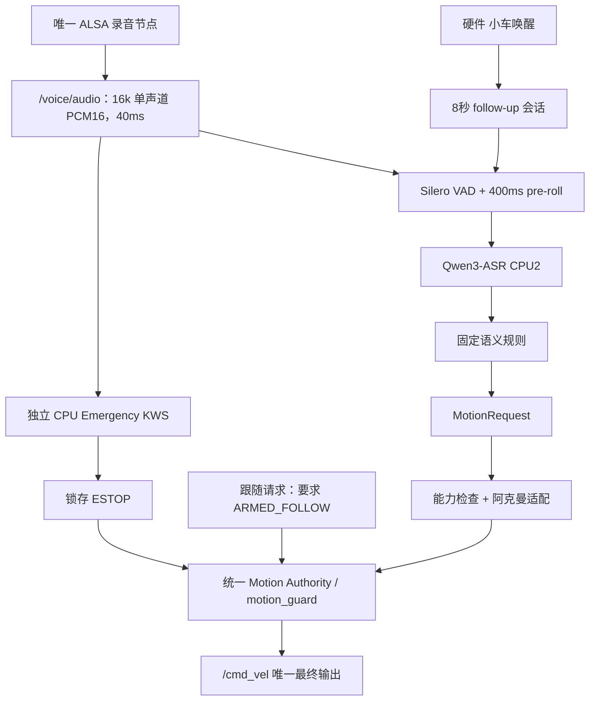

# 语音优化：无车实施与验收（2026-10-04）

本轮按《Orin Nano 小车语音控制系统优化.md》落实能在电脑完成的软件工作。开发基于 `codex/fixed-voice-rules`，未连接、同步或部署到小车。以下是本分支源码状态，不是板端运行状态；历史记录中的实车程序不会因此自动更新。

保留硬件唤醒、Qwen3-ASR 0.6B INT8 / CPU 2 线程、固定规则、MeloTTS 和最终 `motion_guard`。不接入 LLM 运动决策，不切换 ASR，不启用 GPU ASR，不用时间乘速度冒充里程计距离。

## 已实现的链路



录音不会因为播报而暂停。正常 ASR 会丢弃播报期间或被取消的结果，KWS 不订阅唤醒、会话或播报开关。音频丢帧、格式错误、识别器异常会让急停通道失效并触发制动；音频断流会让健康心跳失效，已授权的 guard 进入 FAULT。默认必须有有效 KWS 心跳才能授权。

统一状态为 `DISARMED / ARMED_MANUAL / ARMED_FOLLOW / ESTOP / FAULT`。启动只允许 `IDLE + DISARMED`，`auto_arm=true` 被拒绝。选择模式先停车和清空旧请求；授权必须携带该次模式选择返回的 `authority_epoch`，并且只能在新鲜零请求时进行。停止、故障和模式切换使旧授权票据失效。跟随生产者也检查统一状态，`enabled=true` 本身不会授权运动。

`STOP` 停车并撤销授权；KWS 的四个紧急词和规则中的“急停”进入 `ESTOP`。ESTOP 写入用户状态目录的 `roscar/estop.json`；损坏的记录按锁存处理。普通停止、模式切换、旧授权和节点重启不能解除锁存。每次 guard 启动使用新的授权编号；会话退出或重新唤醒会撤销尚未完成的授权请求。复位只进入未授权状态，必须重新选择模式、取得零请求并显式授权。复位语音使用“解除紧急制动”，避免把“急停”本身再次送入 KWS。

## 按原文优先级完成的修改

每行同时列出问题、目标、代码、实现、接口、风险、测试和验收边界。

| 优先级 / 当前问题 | 目标及涉及文件 / 节点 | 实现与 ROS 接口变化 | 风险 | 测试方法 | 无车验收 / 实车边界 |
|---|---|---|---|---|---|
| P0：启动可自动授权，局部 enabled 与整车许可混用 | `motion_guard/authority.py`、`node.py`、follower、`start_robot.sh`、`start_project.sh` | 单一状态机，启动运动及几何确认默认 false；`/control/state` 新增 authority 状态与 epoch；`AuthorizeMotion.srv` 显式票据；旧 `/control/arm` 默认拒绝 | 老脚本须迁移，旧客户端不能自动恢复 | 随机状态序列、真实 ROS 服务、零请求、模式切换、迟到票据、跟随门控 | 无车通过；整车上电、模式切换仍需现场检查 |
| P0：紧急停止无锁存 | `authority.py`、guard；router 复位规则 | 新增 `/control/estop`、`reset_estop`、`reset_fault`；先输出零，再写锁存；原子文件持久化 | 状态文件损坏会拒绝运动，需要排查并显式复位 | 文件损坏、写入失败、重建状态机；ROS 停止/复位联动 | 软件通过；断电、STM32 实际停车待验收 |
| P0：STOP 依赖普通 ASR 或播报结束 | `audio_node.py`、`emergency_node.py`、`frontend.py`、关键词文件 | CPU1 流式 KWS，四词：停止、停下、急停、别动；`/voice/emergency_healthy`、`/voice/emergency_event`、`/control/emergency_stop` | KWS 可能漏检或因回声误停车；不能当作已经认证的安全装置 | 真实权重 + ROS PCM；模拟 TTS 播放期间触发锁存；断流/故障门控 | 常开通道与联动通过；真实四词召回、电视误触发、STOP P95 待实车录音 |
| P1：RMS 容易把机械噪声当语音，断句慢 | `offline_voice/asr_node.py`、`frontend.py` | 默认 Silero CPU1，保留 400ms pre-roll；600ms 起点，扫描 300/400/500/600/700/800ms；显式 `vad_backend=rms` 回退；达到 15s 上限丢弃不完整指令 | VAD 也可能截断，噪声模型仍需标注 | 实际 VAD 权重、合成/已有 WAV 扫描、真实 ASR 节点取消测试 | 模型 API 与链路通过；端点参数没有据此宣称适合车内 |
| P1：ASR 与 KWS 可能争抢声卡或处理残留录音 | `AudioFrame.msg`、`xfyun_speech/audio_bus.py`、ASR 父类 | 唯一录音所有者；序号、时间戳、格式校验；有界队列；`/voice/cancel_listening`；取消及丢帧丢弃整句 | DDS/CPU 堵塞导致失效停车，需量测 Orin 负载 | 队列溢出、序号跳跃、断流、取消后重听、真实 Qwen 解码 | 无车通过；ALSA 长时稳定性待现场 |
| P1：XFM 硬件能力、AEC 未查清 | `inspect_voice_hardware.py`、`collect_voice_sample.py` | 只读声卡/USB/混音控制调查；准备带播放参考的双讲录音工具；不配置未知 DSP | `plughw -c1` 不能证明硬件只有一通道，也不能证明已有 AEC | 源码调查和本机只读脚本；现场执行 hw 参数及双讲录音 | 代码证据已整理；通道、DSP、NS、AEC、DOA 实际输出待小车 |
| P2：解析器直接生成 Twist，阿克曼零速旋转不可用 | `MotionRequest.msg`、`motion.py`、`motion_adapter_node.py`、router | 语义 MOVE/TURN + direction/style/可选槽位；能力检查后发布 `/chassis/cmd_vel`；阿克曼转向含前进速度；拒绝原地转向 | 舵角/最小半径不是软件计算就能验收；额外原始速度发布者会触发唯一来源保护 | 正负转向、半径边界、NaN/错误类型、重复/过期请求、ROS 微动曲线 | 软件通过；`turn_calibrated=false` 默认保持，须现场标定 |
| P3：热词是否有效未知 | Qwen factory 适配、音频 A/B 工具 | 检查原生 `hotwords` API，1～20 个显式词；默认 `hotwords_enabled=false`，保持原 ASR 模型与 CPU2 | 本轮发现输出整串热词的情况 | 本机真实 Qwen / Silero / Melo 权重，热词开关 × 六端点 | A/B 已完成；当前证据不支持启用，真人数据后重测 |
| P3：文本回归不能证明语音成功率 | `benchmark_voice_audio.py`、采集工具、结果 JSON | WAV + JSONL 标注；CER、关键字、方向级意图准确率、危险误意图、截断、KWS 事件及延迟分位数；未标注指标为 null | 合成 TTS、已有播报和真人车内音频分布不同 | 合成样本与计量单测/回放；保存输入和模型 SHA-256 | 工具和软件回放完成；物理成功率、真实噪声、正常启动与停车 P95 待车 |
| P4：无限监听和唤醒 toggle | `session.py`、router、ASR/TTS 取消服务 | 8s follow-up，可配置 5～10s；唤醒刷新会话，不切换运动许可；支持“不用了 / 退出语音 / 休眠”；播报/当前句识别暂缓窗口，保留 25s 上限 | ASR 推理与 TTS 整句生成无法保证立即释放 CPU | 时间窗口边界、重复唤醒、取消、ROS 播放中 KWS | 软件通过；真实 barge-in 体验和 CPU 排队延迟待测 |
| P4：一下/一点仍执行长时间普通运动 | 语义规则、`ChassisCapabilities` | MICRO 风格；候选 0.05m/s、0.5s，转向 0.1rad/s；拒绝超过微动边界；默认 `micro_calibrated=false` | 静摩擦、载荷可能使候选参数不产生有效位移 | 语义、能力边界、ROS 测试配置的曲线请求 | 实现通过，候选参数没有启用到实车 |

旧 `parse_local_text()` 仅保留为文本回归的兼容视图，运行节点使用 `parse_intent()`，运动经新适配节点执行。旧文本测试里看到的零速旋转参数不代表新的运行输出。旧 `VoiceCommand.DRIVE` 不再作为语音运动入口，调用者应迁移到 `MotionRequest`。

`MotionRequest` 的速度和时长槽位使用 float64，与规则解析及底盘消息精度一致；ROS 回归覆盖速度 0.2 的直行/转弯边界，避免单精度转换误差造成合法指令被限值检查拒绝。

## 本轮实际验证结果

- 本机 Ubuntu 22.04 / ROS 2 Humble 的 x86_64 隔离根文件系统；不是 Jetson / ARM64 性能测试。
- 9 个语音/接口/控制相关包编译通过；另外为旧入口兼容性构建 API 与感知依赖。Python 及 Bash 语法检查、Git 空白检查通过。
- 本机跨进程入口/真实 C++ 驱动的 PTY 模拟回归使用 CycloneDDS，并验证自定义坐标系、SIGTERM 零输出及故障锁存。chroot 中默认 Fast DDS 出现单向发现/无数据，因此没有把它记为该环境下跨进程通过；这不是板端 DDS 验收。旧 API 的底盘 CLI 子场景通过，雷达观察子场景未收到数据、完整脚本仍未通过；该额外回归限制保留在记录中。
- 1618 项包测试通过，包含原有 1546 项文本规则测试。真实 ROS 测试验证正常启动零输出、旧授权失效、锁存复位、音频失效 FAULT、跟随全局授权以及模拟播报期间的真实 KWS 检出。
- 真实 Qwen3 CPU2 + Silero 节点通过 ROS AudioFrame 收音；取消的部分音频没有发布文本，完整的合成“停止”录音产生了“停止”结果。没有打开本机/车端 ALSA。
- 使用真实 Qwen3 0.6B INT8、Silero、KWS 和 MeloTTS 产生 10 条合成数字音频，运行热词开关 × 6 个端点，共 120 次配置样本。另有 2 条合成噪声/静音与 4 条厂商已有反馈 WAV 的前端扫描。

版本化摘要见 [机器可读结果](voice_lab_results/2026-10-04-synthetic-ab-summary.json)。本机完整结果在 `artifacts/voice-lab/synthetic-ab.json`，输入 WAV 在 `artifacts/voice-lab/synthetic/`，权重在本机缓存，不纳入 Git。

600ms 条件下，合成集关闭热词 CER 为 0.3333，开启为 0.8056；方向级意图结果均为 4/10（包含拒绝危险输入的负样本）。合成短词的 TTS/ASR 本身有错误，这些数值不能描述真人车内准确率，也不能用于 ASR 替换决策。热词开启时，“前进”样本输出了整串领域词，规则拒绝执行；本轮据此保留热词关闭。KWS 在合成“停止”和“停下”中检出，在“急停”和“别动”样本中未检出；四词的真实召回仍是部署前必测项。

本轮未给出车端 CER、车端 STOP P95、实际运动成功率或实际危险误动作率。没有声学起止标注的延迟和截断率保持 null；KWS 的计算耗时和 WAV 音频坐标不等于用户开口到机械停车的时间。

补验还发现流偏移会影响合成短词检出：在“停止”前加入 96～111 个 40ms 静音块，101/102/103 三个配置未检出，另外 13 个检出，见[偏移扫描记录](voice_lab_results/2026-10-04-kws-offset-probe.json)。ROS 播报期间急停测试从新 KWS 流回放已知正例，验证事件传递与锁存，不覆盖这种偏移漏检。该结果进一步要求部署前验证连续流四词召回；本轮没有根据合成数据调整生产阈值或默认启用运动。

## 可在电脑复现的工作

在项目根目录执行，先建立隔离 Python 环境并安装固定版本依赖。以下步骤不打开声卡或启动底盘：

```bash
python3 -m venv .venv-voice-lab
. .venv-voice-lab/bin/activate
pip install sherpa-onnx==1.13.8 numpy pytest
python scripts/prepare_voice_frontend.py --root "$PWD/artifacts/voice-lab/models" --download
# 需要复现本轮 Qwen/Melo 数字音频测试时才下载原有 ASR/TTS 权重：
python scripts/prepare_voice_frontend.py --root "$PWD/artifacts/voice-lab/models" --download --include-asr --include-tts
python scripts/prepare_voice_synthetic.py \
  --model artifacts/voice-lab/models/vits-melo-tts-zh_en \
  --output artifacts/voice-lab/synthetic
python scripts/benchmark_voice_audio.py \
  --models artifacts/voice-lab/models \
  --manifest artifacts/voice-lab/synthetic/manifest.jsonl \
  --qwen-model artifacts/voice-lab/models/sherpa-onnx-qwen3-asr-0.6B-int8-2026-03-25 \
  --output artifacts/voice-lab/synthetic-ab.json
```

基准工具强制 16kHz / 单声道 / PCM16 WAV，单文件一段话；其他格式应先显式转换。`expected_intent` 如 `MOVE:FORWARD`、`TURN:LEFT`、`SET_MODE:FOLLOW`、`STOP`、`ESTOP`、`NONE`。人工补充 `speech_start_s / speech_end_s / stop_word_end_s` 后才计算相应延迟和截断率。`NONE` 包含安全规则拒绝，危险误意图单独统计运动/授权请求。

Humble 环境构建当前接口后，可运行 `tests/test_voice_authority_runtime.py`、`tests/test_voice_asr_runtime.py`；设置 `ROSCAR_OFFLINE_MODEL_ROOT` 指向上述权重目录，并使用独立 `ROS_DOMAIN_ID`、`ROS_LOCALHOST_ONLY=1`。前者使用模拟录音和模拟 TTS，测试代码中的几何/微动确认仅用于模拟域，不能复制为实车配置。

## XFM 调查与后续录音

源码 `wheeltec_mic.cpp` 存在 `/awake_angle` 发布和 `set_beam` 服务，这只能证明接口存在，不能证明当前硬件持续提供 DOA、原始多通道或已经启用回声消除。历史实测的 `plughw:CARD=XFMDPV0018,DEV=0`、16k/单声道是软件采集配置。必须现场查看 `hw` 原生能力和 DSP 资料，不能由 `plughw` 的转换输出反推硬件能力。

`scripts/inspect_voice_hardware.py --output artifacts/voice-lab/xfm-hardware.json` 只读列出 USB、ALSA 和混音控制。本轮在无麦阵列的电脑运行了脚本，没有小车硬件结论。实际 `--dump-hw-params` 可能打开录音设备，应在现场停止共享录音后单独检查，不能与 KWS 争抢声卡。

有电脑麦克风时，可以先记录真人近场指令、轻声、快慢语速、否定句、转述句和电视负样本，使用 `collect_voice_sample.py` 建立标注。它明确打开指定声卡，只录音和可选播放，不启动 ROS/底盘。回到小车后补齐：安静、风扇低/高速、电机、舵机、雷达、0.5/1/2/3m、背对、多人、电视、自身 TTS、TTS 双讲停车、运动中停车。双讲需保留播报参考 WAV，并记录软件事件与真实底盘停止时间。

## 回到小车后的验收与启用

源码尚未部署。新消息/服务必须重建同一套 overlay，不能只覆盖 Python；先备份原环境，用运动关闭配置验证 KWS、ASR、唤醒和所有心跳。部署时模型下载到明确目录，核对 manifest；新启动脚本缺 VAD/KWS 权重会报错，不能静默降级后授权。

启动脚本默认 `MOTION_ENABLED=false`，几何、安装和制动确认均 false；`turn_calibrated / micro_calibrated / hotwords_enabled` 也保持 false。先验证车端录音及 KWS 四词，再测上电未授权、STOP、ESTOP 锁存、复位不恢复、节点退出/音频断流。之后由人在场验证转弯半径、微动实际位移、制动距离和 P95，逐项确认参数后才允许显式授权。

授权服务顺序：选择模式取得 epoch → 等待选中生产者的新鲜零请求及健康心跳 → `/control/authorize {authority_epoch: ..., mode: ...}`。默认的 `/control/arm` 已不再兼容旧的无票据自动化。独立原始 `/chassis/cmd_vel` API 示例与语音适配节点不能同时作为发布者；出现多个来源时应保持拒绝运动。

主启动链路只支持固定规则安全路径 `VOICE_BACKEND=offline`，保留 `ASR_BACKEND=xfyun` 作为显式云端识别回退。原 `VOICE_BACKEND=online` 的 DeepSeek 控制入口在主脚本中被拒绝，旧实验文件保留作历史。RMS 回退必须显式选择，并继续使用共享音频和常开 KWS。

里程计距离控制和 Zipformer / Qwen 双 ASR 对照按原文留到后续阶段：没有实车里程计、语音和停车数据时，本轮不启用距离闭环，也不决定更换模型。

模型与 API 依据：[官方 KWS 模型/关键词说明](https://k2-fsa.github.io/sherpa/onnx/kws/pretrained_models/index.html)、[官方 VAD 示例](https://github.com/k2-fsa/sherpa-onnx/blob/v1.13.8/python-api-examples/vad-microphone.py)、[官方 Qwen3 工厂接口](https://github.com/k2-fsa/sherpa-onnx/blob/v1.13.8/sherpa-onnx/python/sherpa_onnx/offline_recognizer.py)。本轮通过本机 v1.13.8 原生库实际加载和回放验证 API；下载 SHA-256 是本机计算的文件记录，不宣称已与发布者签名校验。
