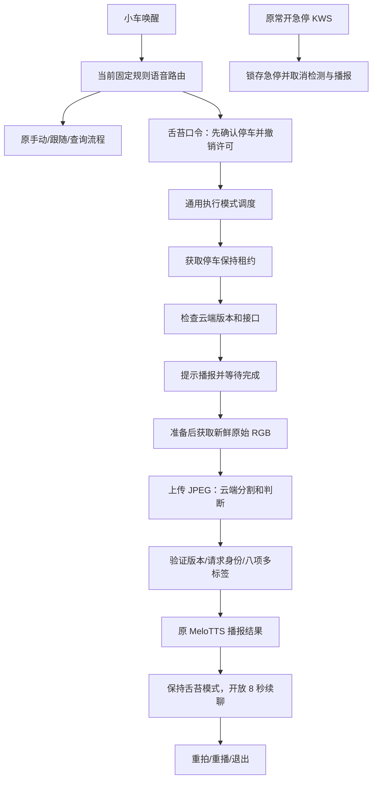

# 语音控制与舌苔判断整合

日期：2026-10-04。开发分支：`codex/voice-tongue-integration`。

本分支从语音优化及使用说明书提交 `0c39068` 创建，移植舌苔项目 `codex/tongue-execution-mode` 的 `1b422ebd2e811f0f29e9c58dad9dc3910505a689`，再适配当前语音链路。原语音工作区和舌苔工作区的分支、未提交修改继续保留。本次没有 SSH、部署、打开真实音频/相机/串口，或向实际舌苔服务器上传图片。

独立工作区：`E:\works\newcar\ROS-CAR-voice-tongue`（WSL：`/mnt/e/works/newcar/ROS-CAR-voice-tongue`）。基础语音工作区仍为 `ROS-CAR`，舌苔来源仍为 `E:\works\tonguemodel\ros_car_tongue_integration\ROS-CAR-tongue`。

## 1. 实际接入的流程



舌苔模式复用现有相机、ASR、共享录音、独立 KWS 和 TTS 队列。新增 `execution_mode_interfaces`、`execution_mode_manager`、`tongue_mode` 三个包；所有最终底盘速度仍由唯一 `motion_guard` 输出。Qwen3-ASR 0.6B INT8 / CPU2、Silero VAD、热词默认关闭和底盘标定默认关闭都保留。

## 2. 使用语音操作

模块启用、服务与设备就绪后，先说“小车唤醒”，等普通播报结束，再发口令。舌苔检测不需要开启手动驾驶授权；进入时会撤销已有运动许可并保持停车。

| 你说的话 | 作用 |
|---|---|
| 舌苔检测 / 舌苔判断 / 开始舌苔检测 / 检查舌苔 | 进入模式并自动检测一次 |
| 重新拍摄 / 重新拍照 / 重新检测舌苔 | 新图、新请求；先取消正在进行的检测 |
| 播报上次结果 / 播报检测结果 | 重播本会话最近一次有效结果，不再次上传 |
| 退出舌苔检测 / 取消舌苔检测 / 退出当前模式 | 清理模式，保持空闲、未授权 |
| 退出语音 / 不用了 / 休眠 | 明确结束语音交互并退出执行模式 |
| 停车 | 普通停车并清理模式，撤销运动许可 |
| 停止 / 停下 / 急停 / 别动 | 独立 KWS 检出会锁存急停并中止检测；按原使用说明书复位 |

进入后会提示正对相机、伸出舌头并保持不动。提示完成后准备约 2 秒，再获取新图。服务器返回后播报识别出的特征，然后等待下一步。

“不要检查舌苔”只请求退出，不拍照。询问、引用、转述及混合动作不触发检测，例如“舌苔检测？”、“他说舌苔检测”、“先检查舌苔再前进”。拍摄/云端等待期间可以重拍或退出；普通会话已超时则先重新唤醒。

重复唤醒保持当前舌苔模式，只刷新普通会话；不会取消正在播放的任务提示或结果。普通 ASR 在播报期间抑制结果，共享录音和急停 KWS 继续运行。约 8 秒的普通监听超时不取消长时间检测；进入 READY 时为语音交互重新开放一个 8 秒窗口，后续无交互就再次关闭，不无限监听。

检测期间“前进”、手动授权和跟随授权会被拒绝。退出、取消、故障或租约到期不会恢复之前的跟随；再次行驶必须重新选择模式并取得新授权。

## 3. 与较早舌苔分支的适配

| 修改 | 原因及当前行为 | 验证 |
|---|---|---|
| 保留新唤醒和有限会话 | 旧舌苔分支使用持续会话/再次唤醒退出；现在刷新会话，任务可跨过窗口运行 | 未唤醒拒绝、重复唤醒保留模式、长云端等待后续聊 |
| 进入模式先确认 STOP | 在异步调度前撤销旧票据，阻止在途授权和缓存运动请求；独立的任务代次避免再次唤醒或旧模式反馈覆盖待进入请求 | 停车握手、再次唤醒/迟到确认/取消竞态、模式内运动拒绝、旧票据失效 |
| TaskHold 接入 Motion Authority | 只在急停/故障已解除且急停通道健康时取得租约；不恢复旧的 auto_arm | 真实 guard 租约、释放/过期、ESTOP 保留 |
| 急停与健康失效终止检测 | 当前 KWS 常开；guard 状态及健康字段让模式中止并丢弃迟到响应 | 真实 KWS 正例联动；模拟网络等待取消和健康失效 |
| 合并 TTS 两类任务 | 普通播报保留取消代次；SpeakText 使用同一队列，完成后才允许拍照；调度器反馈同原语音反馈一样替换急停触发词，减少自身播报干扰 | 播报失败、取消、普通语音回归；修复播放进程启动时取消竞态；真实回声待实机验收 |
| 图像与里程计时间校验 | RGB 接收时间和 ROS 源时间均需晚于捕获窗口；底盘反馈的源时间也需新鲜 | 旧图拒绝、帧窗口单测、模拟静止回传 |
| 词表保留句子上下文 | 不删除疑问和引号；核心运动/停车/复位词不能被模式词表覆盖 | 词表及原固定语义规则回归 |
| 整机监督入口接入 | 显式开关派发模式组件，并给现有唯一 router/TTS 配置词表和完成接口 | Shell 语法、配置预检；实机整机启动待验收 |

任务使用 3 秒停车租约、约 0.5 秒续租和调度器心跳；模式切换等待旧 RunMode 最终结束。默认任务上限 150 秒用于当前云端调试配置，普通监听和接口等待仍分别有上限。HTTP 客户端可取消连接并丢弃旧结果，服务器已开始的推理可能继续执行。

## 4. 启用与构建

新增消息/action/service 必须和语音及 guard 一起构建，不能只替换 Python。源包结构为 17 个主动包，本轮实际构建舌苔相关依赖与业务包 12 个。

在 Humble 专用工作区内执行：

```bash
source /opt/ros/humble/setup.bash
rosdep install --from-paths ros2_ws/src --ignore-src -r -y
colcon --log-base log build --base-paths ros2_ws/src --packages-up-to tongue_mode \
  --build-base build --install-base install --symlink-install
source install/setup.bash
```

这些是构建命令。下列启动示例只用于回到小车后、准备好对应环境的人工调试，本轮没有执行：

**整机已有配置：** 在包含这次构建及 B/相机/底盘等既有依赖的专用副本中：

```bash
WITH_TONGUE_MODE=true TONGUE_SERVER_URL=http://已核对的服务器地址:端口 \
  bash scripts/start_robot.sh
```

原运动开关和标定开关默认仍关闭；启动相机、底盘回传和模块不授权行驶。robot 安全配置要求新鲜、持续静止的底盘回传。此入口统一监督并清理舌苔、语音和原组件，不能再叠加启动第二套 guard/router/TTS。若需要使用原有栈而只替换模块，按[模块部署说明](舌苔检测模式开发与部署说明.md)进行受控替换。

**没有底盘的台架：** 已有单一 RGB 相机驱动、没有其他语音或 guard 时：

```bash
bash scripts/run_tongue_mode.sh safety_profile:=bench with_guard:=true with_voice:=true \
  server_url:=http://已核对的服务器地址:端口
```

bench 要求运动关闭，仍需要健康的急停通道。它不启动相机或底盘，不能当作车辆停稳验收。整机监督脚本也支持 `TONGUE_SAFETY_PROFILE=bench`，要求 `WITH_FOLLOWER=true` 提供唯一 guard、`WITH_VOICE=true` 和 `MOTION_ENABLED=false`；robot 则额外要求 `WITH_CHASSIS=true`。`WITH_TONGUE_MODE` 默认 false，启用后缺少依赖会明确退出。

默认服务器地址来自来源分支的历史配置 `http://172.19.128.171:8096`，本轮没有验证可达。必须确认实际 URL、跨网段路由和服务版本；不要假定当前地址就是可用服务。

云端冻结 `cloud_r50_384_cvAC10_passthrough_debug`，digest 为 `c5b9b1e31f73515b44044569b66e64d49861880441273a1fb86cd84774d6a494`。地址覆盖不能替代版本校验。图片默认不保存，结果和事件记录在用户状态目录；凭据只通过环境提供，不入 Git。

## 5. 没有小车时如何复现

```bash
# 有 ROS 2 Humble 的独立 Linux 环境，localhost / 隔离 domain：
bash scripts/test_tongue_mode.sh
```

脚本执行单测、构建和模拟闭环，没有 Humble 时会明确报告尚未验证 ROS 并返回 2。脚本里的 RGB、播报、底盘回传和云端分类为模拟输入，HTTP 仅访问本机临时测试服务。

真实权重的语音回归另需准备原有 Qwen/Silero/KWS 权重和已知正例 WAV，再在已构建环境中设置：

```bash
export ROS_DOMAIN_ID=219 ROS_LOCALHOST_ONLY=1
export ROSCAR_OFFLINE_MODEL_ROOT=/明确的本机权重目录
export VOICE_TEST_STOP_WAV=/明确的合成停止录音.wav
python3 tests/test_tongue_kws_runtime.py
python3 tests/test_voice_authority_runtime.py
python3 tests/test_voice_asr_runtime.py
```

KWS 测试显式从新流回放已知正例，用于确认播报中联动，不代表任意流偏移的召回。上一轮“四词及偏移漏检”的记录继续有效，见[语音优化无车实施与验收](语音优化无车实施与验收.md)。

## 6. 当前验证范围

- 专用本机 Ubuntu 22.04 / Humble x86_64 根文件系统，独立于两个源工作区；代码只挂载本整合工作区到 `/vt-workspace`，构建输出在根文件系统专用目录。未复用来源分支曾发生覆盖事故的 workspace。
- 12 个舌苔/语音/控制依赖包编译通过。接口包有 CMake 未使用变量提示，不是编译失败。
- 1655 项相关包及舌苔纯逻辑/ROS 单元测试通过，包括待停车确认时再次唤醒、旧模式反馈及退出后迟到确认三个边界。
- 舌苔闭环 17 个场景通过，包括真实 action/service/pub-sub、JPEG/HTTP 协议、重拍、取消、旧帧、错误版本、播报失败、旧任务迟到结果、串行模式切换、健康失效及长任务后的有限续聊。最终模拟上传 12 次、保存 9 个有效协议结果；差额包含取消请求。
- 独立停车租约真实 ROS 回归通过：显式票据授权、独占/token/续租、释放和到期不恢复、旧票据拒绝、急停锁存不能被释放清除。
- 原语音授权/适配/跟随/急停回归和控制 API 回归通过；原 Qwen3/Silero 共享音频及取消链路的真实权重回放也通过。
- 实际 CPU KWS 在模拟 SpeakText 提示播报中检出已知“停止”正例，锁存 ESTOP、取消提示及模式，确认未拍照上传和未恢复运动。声学播报、相机和云端分类仍是模拟。
- 项目结构检查通过：17 个包、245 个 Python 文件；5 个相关 Shell 脚本语法通过，6 种无效舌苔启动配置在启动 ROS/设备前拒绝。

## 7. 留待实车的工作

未验证 Jetson/aarch64 性能、真人转写“舌苔检测”、真实四词召回、自身播报回声、近距离舌体合焦与光照、实际停车、服务器路由或模型分类准确率。模型输出是八项舌象特征，不是疾病诊断；“未检出黄苔/厚苔”不推导成“白苔/薄苔”或身体健康。

回到小车先以运动关闭配置验收唤醒、取消、播报、取新图、服务器版本及结果，再测试急停/健康断流/重拍/断网/退出不恢复跟随。需要评价识别质量时使用真人录音和人工参考标签，不能使用本轮模拟数据替代。

原方向控制用法见[语音控制使用说明书](语音控制使用说明书.md)，舌苔接口与协议细节见[模块部署说明](舌苔检测模式开发与部署说明.md)，来源分支历史测试见[原始验证记录](舌苔检测模式验证记录.md)。
